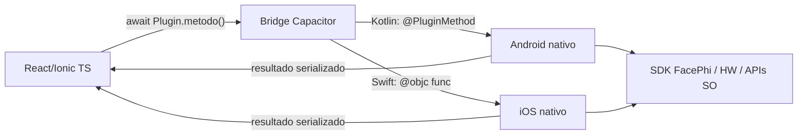
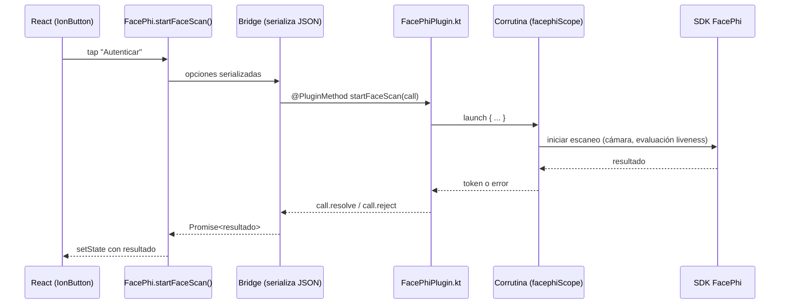
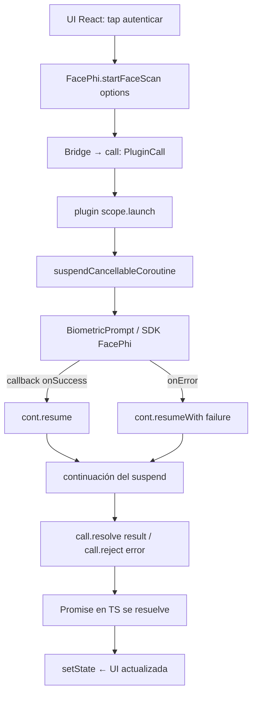

# Guía de Aprendizaje: Integración SDK móvil FacePhi (INGIF-1442)

> Material basado en tu matriz de competencias + la estructura real de PRACTICA-MOVIL.
> Objetivo: pasar de "consumir plugins" a **desarrollar/rescribir plugins híbridos** con lado nativo Kotlin/Swift.

---

## PARTE 0 — Ruta de aprendizaje sugerida (orden y por qué)

| Semana | Tema | Meta verificable |
|--------|------|------------------|
| 1 | Plugins Capacitor: ciclo completo (TS → bridge → Android) | Crear un plugin "Echo" propio que compile y corra en dispositivo |
| 2 | Kotlin básico para devs TS: clases, null-safety, lambdas | Portar un util de TS a Kotlin |
| 3 | Corrutinas: suspend, launch, async, Dispatchers, scopes | Migrar un callback a suspend fun |
| 4 | Callbacks → Corrutinas (patrón FacePhi) | Envolver una API de callbacks en suspendCancellableCoroutine |
| 5 | Android 15/16: WindowInsets, edge-to-edge, 16 KB page size, target SDK | Pasar checklist de requisitos Google Play |
| 6 | iOS: Swift, .xcframework, CocoaPods | Compilar la versión iOS de tu plugin |
| 7 | Integración: biometría + almacenamiento seguro de credenciales | Mini-app que autentica con biometría y guarda token en Keychain/Keystore |

**Prioridad crítica** (según matriz): semana 1–5. El resto refuerza el perfil base.

---

## PARTE 1 — PLUGINS HÍBRIDOS: de consumir a desarrollar

### 1.1 El puente en una frase

La app es un **WebView** (tu React/Ionic) que habla con **código nativo** (Kotlin/Swift) a través de un "puente" que serializa llamadas. Un plugin es el par de implementaciones (JS + nativo) + el contrato entre ellas.



### 1.2 Los DOS modelos que Dice la matriz: Cordova vs Capacitor

Tu proyecto ya tiene esto documentado en código, en `src/lib/echo-consumo.ts`. Léelo, es tu mejor material:

| Aspecto | Cordova | Capacitor |
|---|---|---|
| Exposición JS | Global en `window` (ej: `window.Echo`) tras `deviceready` | Módulo ESM con `registerPlugin` + Promesas |
| Registro nativo | `plugin.xml` / `config.xml`,esson features | Auto-registrado; `npx cap sync` copia código a `android/` `ios/` |
| Tipado | Pobre (globales sin tipos) | Interfaz TS + generics de `registerPlugin<T>` |
| Fallback web | Manual | Definido en la propia llamada (`web: () => ...`) |
| Mazo de código nativo | Recurso del plugin | Todo el proyecto nativo es TUYO (`android/` completo) |

**Punto crítico de la matriz:** "rescribir el lado nativo". En Cordova solo consumes; en Capacitor el proyecto nativo entero vive en tu repo (`android/`, `ios/`) — puedes editar el Kotlin/Swift del SDK FacePhi directamente.

### 1.3 Anatomía de un plugin Capacitor propio (lado Android)

Los 3 archivos que siempre existen:

**a) Contrato TS** (como `BateriaAPI` en `src/lib/bateria-plugin.ts`):

```ts
// src/plugins/facephi/index.ts
export interface FacePhiPlugin {
  /** Lanza el proceso de escaneo facial. Cambia de callback a Promise (corrutina en nativo). */
  startFaceScan(options: { liveness: boolean }): Promise<{ success: boolean; token?: string; error?: string }>;
}
export const FacePhi = registerPlugin<FacePhiPlugin>('FacePhi');
```

**b) Implementación nativa Kotlin** (`android/app/src/main/java/.../FacePhiPlugin.kt`):

```kotlin
@CapacitorPlugin(name = "FacePhi")
class FacePhiPlugin : Plugin() {

    @PluginMethod
    fun startFaceScan(call: PluginCall) {
        val liveness = call.getBoolean("liveness", true)

        launchCoro { // corrutina en el scope del plugin
            try {
                val token = FacePhiSdk.startScan(liveness = liveness) // suspend, ver PARTE 2
                val ret = JSObject()
                ret.put("success", true)
                ret.put("token", token)
                call.resolve(ret)
            } catch (e: FacePhiError) {
                call.reject("FACEPHI_ERROR", e.message, e)
            }
        }
    }
}
```

**c) Registro** (en Capacitor 8 no hace falta XML — el plugin vive en el paquete y `npx cap sync` lo detecta).

### 1.4 Ciclo de vida de UNA llamada (visual)



### 1.5 Caso práctico 1: construir un plugin "Echo" end-to-end

Ya existe el **consumo** en tu repo (`echo-consumo.ts`). Lo que falta es el **lado nativo**, y esa es la habilidad pedia:

1. `npx cap add android` (si no tienes carpeta `android/`).
2. Crea `EchoPlugin.kt`:

```kotlin
@CapacitorPlugin(name = "Echo")
class EchoPlugin : Plugin() {
    @PluginMethod
    fun echo(call: PluginCall) {
        val msg = call.getString("msg") ?: ""
        val ret = JSObject().apply { put("msg", msg.uppercase()) }
        call.resolve(ret)
    }
}
```

3. Consume com la plena interfaz TS ya existente (`consumirCapacitorEcho`).
4. `npm build && npx cap sync && npx cap run android` — prueba en emulador con "hola".

**Verificación de aprendizaje:** si en el emulador ves "HOLA" en mayúsculas, cruzaste el puente completo TS→Kotlin→TS.

### 1.6 Caso práctico 2: Cordova legacy dentro de Capacitor (lo que pediría la migración)

Tu `cordova-compat.ts` muestra el acceso global. Para "rescribir el lado nativo" de un plugin Cordova legacy:

1. Lee el global que inyecta (ej: `navigator.vibration`) — así detectas su API.
2. Localiza su Java `@CordovaPlugin` (consumido desde el bridge de compatibilidad).
3. Porta la lógica a un `@CapacitorPlugin` (Kotlin) con el MISMO contrato TS → cambia el global por import tipado.
4. Elimina la dependencia Cordova (`npx cap rm` / drop del plugin) y prueba.

---

## PARTE 2 — KOTLIN CON CORRUTINAS (forma explícita)

### 2.1 Por qué te lo pide la matriz

"La nueva línea del SDK Mobile de FacePhi cambió su API de callbacks a corrutinas". Antes integrabas así:

**ANTES (callbacks — estilo viejo):**
```kotlin
facePhi.startScan(liveness, object : ScanCallback {
    override fun onSuccess(token: String) { /* ... */ }
    override fun onError(e: Throwable) { /* ... */ }
})
```

**DESPUÉS (corrutinas — estilo nuevo):**
```kotlin
val token = facePhi.startScan(liveness = true) // suspend fun: se PAUSA sin bloquear
```

Tu trabajo como integrador: **envolver la API nueva (o portar la vieja)** para que el plugin Capacitor resuelva `call.resolve/reject` con el resultado de la corrutina.

### 2.2 Vocabulario mínimo (con tu analogía TS de referencia)

| Kotlin | TS/JS equivalente | Nota clave |
|---|---|---|
| `suspend fun` | `async function` | Solo se puede llamar desde otra corrutina |
| `launch` | `void Promise` (no awaited) | Fire-and-forget; devuelve `Job` |
| `async / await` | `Promise.all` + `await` | `async {}` devuelve `Deferred<T>`; `.await()` espera |
| `Dispatchers.IO` | ~ Web Workers / fetch | Para red/disco/cámara |
| `Dispatchers.Main` | hilo de render/UI | Solo tocar UI aquí |
| `withContext(IO) { }` | cambia de contexto para un bloque | Vuelve automáticamente al terminar |
| `CoroutineScope` | contexto de vida (useEffect cleanup) | Cancela automáticamente al morir (ViewModel/Plugin) |
| `Job` / cancelación | AbortController | `.cancel()` cancela el subárbol |

### 2.3 Reglas de oro (fallos típicos de entrevista)

1. **`main { }` sí puede llamar `suspend`** (es un scope con dispatcher Main).
2. **Nunca bloquees Main**: trabajo de red/disco → `withContext(Dispatchers.IO)`.
3. **Un `suspend fun` siempre tiene dueño** (scope) — si la corrutina muere, la llamada se cancela.
4. **Estructura (structured concurrency)**: corrutinas hijo cancelan con su padre; no "fugas".
5. **No hagas `GlobalScope.launch`** en producción — viola la regla 3.

### 2.4 La pieza clave del proyecto: callbacks → suspend con `suspendCancellableCoroutine`

Este es el patrón exacto que plástico entre "API vieja" y "API nueva" (o al integrar un SDK que aún da callbacks):

```kotlin
// Envolver una API de callbacks (ej: biometría nativa) en una suspend fun
suspend fun autenticaBiometrico(): BiometricResult =
    suspendCancellableCoroutine { cont ->
        val prompt = BiometricPrompt(
            activity,
           监视 executor,
            object : AuthenticationCallback() {
                override fun onSucceeded(r: AuthenticationResult) { cont.resume(TOKEN_OK(r)) }
                override fun onFailed() { cont.resumeWith(Result.failure(BiometricError())) }
            })
        prompt.authenticate(...)
        // Si la corrutina se cancela (Activity destruida), liberamos recursos:
        cont.invokeOnCancellation { prompt.cancelAuthentication() }
    }
```

**Por qué importa aquí:** el plugin Capacitor (PARTE 1.3) llama `FacePhiSdk.startScan(...)` como `suspend fun` — y eso gracias a este patrón de envoltura.

### 2.5 Flujo completo: donde todo se junta (visual)



### 2.6 Ejercicio guiado Kotlin

1. Crea en `android/app/src/main/java/...` el archivo `DemoCoroutines.kt`:

```kotlin
import kotlinx.coroutines.*

suspend fun leerNivelBateria(): Int = withContext(Dispatchers.IO) {
    delay(300) // simula HW/SDK lento
    73
}

suspend fun disponible(): Boolean = withContext(Dispatchers.IO) {
    delay(100); true
}

fun main() = runBlocking {
    // Paralelo con async/await
    val bateria = async { leerNivelBateria() }
    val disp    = async { disponible() }
    println("Batería ${bateria.await()}%, disponible: ${disp.await()}")
}
```

2. Cambia `Dispatchers.IO` por `Main` y observa (teóricamente) por qué crashea en un Activity real.
3. Bonus: crea una clase que implemente `ScanCallback` (callback) y envuélvela con `suspendCancellableCoroutine`.

**Criterio de éxito:** sabes explicar POR QUÉ no hay callback hell (la corrutina "se pausa" en el await y la UI sigue fluida).

---

## PARTE 3 — Android 15/16 (requisitos bloqueantes de Google Play)

Conceptos exactos nombrados en la matriz:

| Requisito | Qué es | Efecto práctico en tu app |
|---|---|---|
| **WindowInsets / edge-to-edge** | El contenido puede pintar bar el statusbar/navbar | La cámara preview (tu `toBack: true`) debe respetar insets; usa `WindowCompat.setDecorFitsSystemWindows(window, false)` + `OnApplyWindowInsetsListener` |
| **16 KB page size** | Dispositivos nuevos con páginas de memoria de 16 KB | Las `.so` nativas (lib del SDK FacePhi) deben estar alineadas; si no, la app no instala |
| **target SDK 35/36 alineado** | Debes compilar contra el último SDK publicado | Cambia `compileSdk`/`targetSdk` en `android/app/build.gradle` |
| **Permisos declarados correctamente** | Play Store rechaza si no justificas cámara/biometría | Documenta permisos en `AndroidManifest.xml` + consola Play |

**Ejercicio:** tras agregar `android/`, abre `app/build.gradle` y sube `compileSdk`/`targetSdk`; agrega la lib de `androidx.core` y prueba el preview de cámara en un emulador API 35 con fullscreen (edge-to-edge).

---

## PARTE 4 — Cómo se conecta todo en TU ESTRUCTURA ( mapa actual + futura)

### Actual (web/demo, sin carpeta android)

```
src/pages/*  →  src/lib/* (wrappers, fallback web)  →  plugins npm (@capacitor/*, @capgo/*)
```

Aplicación de concepto: los wrappers (`nativo.ts`, `camara-preview.ts`) ya son "la capa de plugin" del lado TS. Solo falta el lado nativo.

### Futuro (después de npx cap add android)

```
src/lib/facephi.ts                       ← nuevo wrapper TS (contrato tipado)
android/app/.../FacePhiPlugin.kt         ← nativo Kotlin con corrutinas
android/app/.../FacePhiSdkAdapter.kt     ← suspend fun que envuelve el SDK FacePhi
```

---

## PARTE 5 — Plan de práctica con este repo (checklist accionable)

- [ ] Lee comentario por comentario `src/lib/nativo.ts` (patrón: detectar → try/catch → fallback).
- [ ] Lee `echo-consumo.ts` y reconoce los DOS modelos (Cordova global vs Capacitor registerPlugin).
- [ ] Crea el plugin Echo nativo (1.5) con `npx cap add android` y prueba en emulador.
- [ ] Escribe `DemoCoroutines.kt` (2.6) y corre en tu IDE Kotlin.
- [ ] Modifica `EchoPlugin.kt` para usar una corrutina (`launch` + `delay(500)`) y observe que la respuesta llega asincrónica sin bloquear UI.
- [ ] Sube compileSdk/targetSdk y prueba el preview de cámara (edge-to-edge) en API 35.
- [ ] Escribe un `README` de 10 líneas explicando fehaciente el flujo: tap → bridge → corrutina → SDK → resolve → setState.

---

## PARTE 6 — Glosario rápido para entrevista (memoriza en voz alta)

- **Plugin híbrido**: contrato TS + implementaci contraposiciones nativa por plataforma + puente que serializa.
- **`registerPlugin`**: registra el módulo y decide a qué implementación delegar (web/nativo).
- **`PluginCall`**: objeto que representa UNA llamada del puente; `resolve/reject`.
- **`suspend fun`**: función pausable sin bloquear hilo.
- **Dispatcher**: hilo/contexto donde corre la corrutina.
- **Structured concurrency**: el ciclo de vida de las corrutinas está acotado a su scope.
- **`suspendCancellableCoroutine`**: puente callback → suspend (el patrón de migración FacePhi).
- **Edge-to-edge**: dibujar delante de las barras del sistema respetando WindowInsets.
- **16 KB page size**: compatibilidad de binarios nativos con nueva arquitectura de memoria.

---

## Notas

- Este documento usa Mermaid (se ve renderizado en GitHub/VS Code con extensión Mermaid).
- Si quieres, puedo generar la carpeta `android/` de ejemplo con el plugin Echo + DemoCoroutines listos para compilar.
